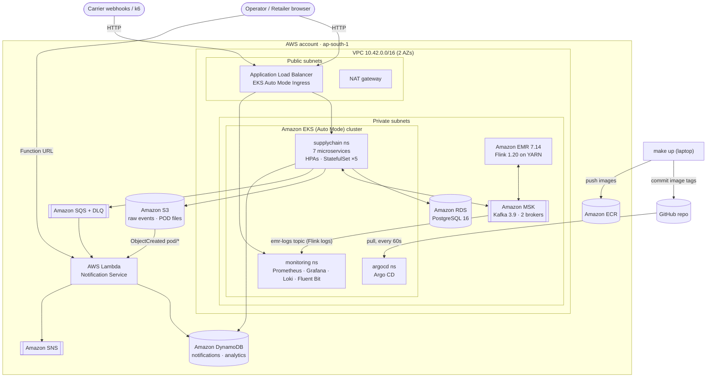
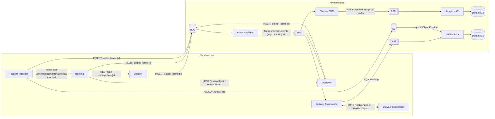
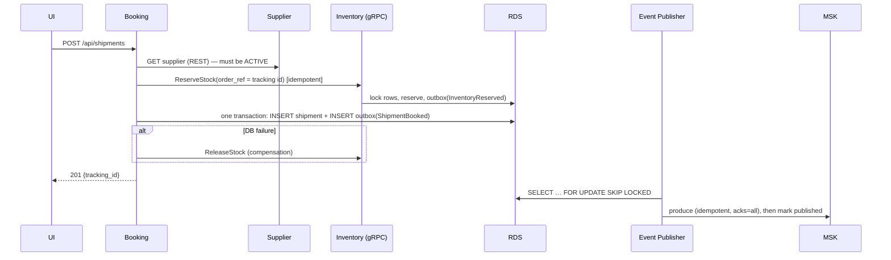
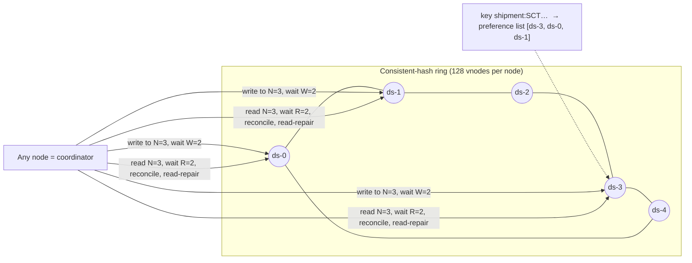

# Design Document — Supply Chain Shipment Tracking on AWS

**Course:** CS/SS G527 Cloud Computing · **Domain:** Supply chain — shipment tracking from suppliers to retailers
**Required concept:** Leaderless replication / Dynamo-like storage system
**Cloud:** Amazon Web Services (region `ap-south-1` by default)

---

## 1. System overview

Suppliers ship goods to retailers through third-party carriers. The platform lets an operator register
suppliers, keep stock, book shipments (which reserves stock and issues a tracking ID), ingest carrier
scan events at high volume, derive the live status of every shipment, notify stakeholders of important
changes, and compute real-time logistics KPIs (transit time, delay, event-processing lag).

| # | Microservice | Runs on | Responsibility | Talks via |
|---|---|---|---|---|
| 1 | **Supplier Service** | EKS Deployment | CRUD of supplier records | REST; outbox → Kafka |
| 2 | **Shipment Booking Service** | EKS Deployment + **HPA** | Creates shipments, assigns tracking IDs, saga with inventory; serves the web UI | REST in/out, **gRPC client**, outbox |
| 3 | **Inventory Service** | EKS Deployment + **HPA** | Stock on hand / reserved; reservations; dispatch on pickup | REST, **gRPC server**, Kafka consumer, outbox |
| 4 | **Tracking Ingestion Service** | EKS Deployment + **HPA** | Receives carrier status events (webhooks), validates, de-duplicates, archives raw data to S3 | REST in, REST to Booking, outbox |
| 5 | **Event Publisher** | EKS Deployment (×2) | Transactional-outbox relay: Postgres → Kafka (at-least-once, ordered per key) | Kafka producer |
| 6 | **Delivery Status Service** | EKS **StatefulSet** (×5) | Derives the current state of each shipment; **is the Dynamo-style leaderless store** | Kafka consumer, **gRPC between nodes**, REST, SQS producer |
| 7 | **Notification Service** | **AWS Lambda** (serverless) | Asynchronous, event-driven notifications (SQS + S3 triggers), idempotent, SNS fan-out | SQS, S3 events, Function URL |
| 8 | **Shipment Analytics Service** | **Apache Flink on Amazon EMR** + query API on EKS | Stateful 1-minute windows + per-shipment keyed state; results to a separate Kafka topic → DynamoDB | Kafka in/out, REST |

### Requirement traceability

| Req | Where it is satisfied |
|---|---|
| a. IaC | `infra/terraform/01-platform` (VPC, EKS, RDS, MSK, DynamoDB, S3, SQS, SNS, Lambda, EMR, ECR, IAM, Pod Identity) and `02-bootstrap` (namespaces, env bindings, Argo CD). Nothing is created by hand. |
| b. Serverless + REST/gRPC/MQ | Notification Service is a Lambda triggered by SQS and S3. REST (public API, Booking→Supplier, Ingestion→Booking), gRPC (Booking→Inventory, Dynamo internode), message queues (Amazon MSK/Kafka topics + Amazon SQS). |
| c. Managed K8s + HPA + load test | Amazon EKS (Auto Mode). HPAs on tracking-ingestion, booking-service, inventory-service (CPU/memory). k6 scripts in `loadtest/k6`. |
| d. GitOps | Argo CD app-of-apps tracks `deploy/argocd/apps`; a release is a Git commit of new image tags (`make up` / `scripts/up.sh images`). No `kubectl apply` for services. |
| e. Flink on managed cluster | `analytics/flink-job` on Amazon EMR 7.14 (Flink 1.20) consuming `shipment-events` from MSK, event-time tumbling 1-min windows + keyed state, writing to `shipment-analytics-results`. |
| f. Concept | Leaderless Dynamo-style replicated store embedded in Delivery Status (consistent hashing + vnodes, N/R/W quorums, vector clocks, sloppy quorum, hinted handoff, read repair, Merkle anti-entropy). §5. |
| g. 3 storage products | Amazon S3 (raw carrier events, proof-of-delivery files that trigger Lambda), Amazon RDS PostgreSQL (relational data + outbox), Amazon DynamoDB (notifications, analytics results). Plus EBS volumes for the Dynamo nodes. |
| h. Observability | Prometheus + Grafana (kube-prometheus-stack) with a custom dashboard (RPS, error rate, latency, HPA, cluster health, pipeline, Dynamo store, analytics), PrometheusRules; centralized logs with Fluent Bit → Loki for all pods **and** the Flink job on EMR (Fluent Bit bootstrap action), Lambda logs via the Grafana CloudWatch data source. |

---

## 2. Cloud deployment architecture

**Why these managed services**

* **EKS Auto Mode** — AWS manages the control plane *and* node lifecycle (Karpenter-based provisioning,
  CNI, CoreDNS, EBS CSI, ALB/NLB controller, Pod Identity agent). Terraform declares only the cluster;
  HPA scale-outs automatically get new nodes. Less undifferentiated work than self-managed node groups.
* **RDS PostgreSQL** — strong consistency and multi-row transactions are exactly what the transactional
  outbox needs (business row + event in one commit). Schema-per-service keeps ownership boundaries.
* **MSK** — managed Kafka: partitioned, ordered per key (tracking ID), replayable log consumed
  independently by Delivery Status, Inventory and Flink (pub/sub with independent consumer groups).
* **SQS** — the right tool for a work queue with retries/DLQ in front of a Lambda; decouples
  notification latency/failures from status derivation.
* **DynamoDB** — key-value/document store for write-heavy, schema-light data (notification feed with
  conditional-put idempotency; time-series analytics results) with zero capacity planning (on-demand).
* **S3** — cheap, durable object storage for the raw event archive (NDJSON.gz partitioned by date/hour)
  and proof-of-delivery files; S3 event notifications drive the serverless function.
* **EMR** — managed Hadoop/YARN with Flink pre-installed; checkpoints to HDFS; logs to S3 and Loki.
* **Pod Identity** — pods get scoped IAM roles (e.g. only `s3:PutObject` on `raw/*`); no static keys.

---

## 3. Microservices architecture and interconnection

| Interaction | Mechanism | Why this mechanism |
|---|---|---|
| Clients/carriers → services | REST over the ALB | Universal, cacheable, easy for third parties (carrier webhooks) and the browser UI. |
| Booking → Supplier | REST | Simple read of a resource; tolerant of loose coupling. |
| Booking → Inventory | **gRPC** (HTTP/2, protobuf, deadlines) | Latency-critical, strongly-typed, synchronous reservation inside the booking request; headless Service + client-side round-robin balances long-lived HTTP/2 connections across pods. |
| Delivery Status node ↔ node | **gRPC** | High-frequency internode replication protocol (quorum reads/writes, Merkle trees) needs low overhead and strict contracts. |
| Services → everyone | **Kafka (MSK)** via transactional outbox | Durable, ordered per shipment, replayable; multiple independent consumers (status, inventory, Flink) without coupling the producers to them. |
| Delivery Status → Notification | **SQS** → Lambda | Work queue semantics, retries, DLQ, partial-batch failure; scales to zero with Lambda. |
| Flink → Analytics API | Kafka results topic | Requirement e; decouples the stream job from storage/serving. |

### Key flows

**Book a shipment (saga + outbox)**

**Carrier event → status → notification**: Ingestion validates & dedups (`carrier_event_id` primary
key) → outbox → Kafka → Delivery Status coordinator: quorum **read** (R=2) → apply event → quorum
**write** (W=2) → on a significant transition (BOOKED, PICKED_UP, OUT_FOR_DELIVERY, DELIVERED, DELAYED,
EXCEPTION, CANCELLED, RETURNED) send an SQS message → Lambda stores it idempotently in DynamoDB and
publishes to SNS (e-mail subscribers filter on `severity=HIGH`).

### Reliability properties

* **No dual writes**: every producer writes its event in the same DB transaction as its state change.
* **At-least-once everywhere, effectively-once outcomes**: Kafka offsets stored only after success;
  consumers are idempotent (event-id set union in Delivery Status, reservation state machine in
  Inventory, conditional put in Lambda, unique carrier event id in Ingestion).
* **Order independence**: shipment status is derived by replaying events in *event time*, so late or
  out-of-order carrier scans never regress a shipment.
* **Compensation**: booking failure after reservation releases stock (saga).

---

## 4. Shipment Analytics (Flink on EMR)

* **Source**: `KafkaSource` on `shipment-events`; event time = Kafka record timestamp (set by the
  Event Publisher to `published_at`); bounded out-of-orderness 5 s; idle partitions handled with
  `withIdleness` and the publisher's per-partition **heartbeats**, so windows close even at low traffic.
* **Stateful windowed aggregation**: `keyBy(carrier)` → 1-minute **tumbling event-time windows** →
  count, **distinct shipments** (set state), DELAYED/EXCEPTION/DELIVERED counts, avg/max
  ingest→stream latency.
* **Keyed state**: `keyBy(tracking_id)` → `KeyedProcessFunction` with `ValueState` (promised date,
  first pickup, first delivery; 30-day TTL) → emits transit hours, delay minutes, on-time flag once both
  ends are known (robust to out-of-order scans).
* A second window (`windowAll`, 1 min) aggregates delivery KPIs (avg transit, on-time ratio).
* **Sink**: `KafkaSink` → `shipment-analytics-results`; checkpoints every 30 s to HDFS.
* **Serving**: `analytics-api` consumes the results into DynamoDB (`pk = carrier_window#DHL`,
  `sk = window_start`) and exposes REST + Prometheus gauges (shown in Grafana and the UI).

---

## 5. Concept: leaderless replication / Dynamo-style storage

The Delivery Status Service owns the *current state of every shipment* — the hottest read path of the
system (tracking pages, status checks) and a write on every carrier scan. It is implemented as an
**embedded, leaderless, Dynamo-style replicated key-value store** across the 5 StatefulSet pods
(`services/delivery-status/app/dynamo`).

| Dynamo technique | Implementation here |
|---|---|
| Partitioning | `Ring`: MD5 ring, 128 virtual nodes per physical node; preference list = first N distinct nodes clockwise. Adding a node moves ≈ 1/(n+1) of keys (unit-tested). |
| Leaderless replication | Every pod can coordinate any key (`coordinate_put/get`); clients hit any pod through the Service/ALB; no primary, no failover. Deliberately **no leader election** (unlike Raft/Paxos, which elect one node to order writes): availability comes from quorums, and consistency from vector clocks + reconciliation. |
| Tunable consistency | N=3, R=2, W=2 (R+W>N ⇒ read-your-writes on a healthy ring); `?r=1..3` per request on the status API. |
| Versioning | **Vector clocks** per version; concurrent versions are kept as **siblings**. |
| Conflict resolution | Syntactic (clock dominance) + **semantic**: the value is an event set, merge = set union (a CRDT; compaction keeps it commutative/associative/idempotent), and the derived status is a pure function of the set — so siblings never lose updates. The reconciled value is written back. |
| Sloppy quorum & hinted handoff | If a preference-list node is down the next healthy node on the ring accepts the write with a *hint*; a background task hands hints back when the owner returns. |
| Read repair | Replicas that returned stale versions during a read are updated asynchronously. |
| Anti-entropy | Per peer pair, a Merkle tree (64 leaves) over shared keys is compared; only differing buckets are exchanged (`MerkleLeaves`, `SyncBucket` gRPC). |
| Failure detection | gRPC pings every 2 s; RPC failures mark peers down immediately. |
| Durability | SQLite (WAL) per node on its own gp3 EBS PersistentVolume. |

**Why leaderless for this domain**: tracking state must stay writable during node failures (carriers
keep scanning); updates commute (they are scans), so eventual consistency with deterministic merge is
acceptable and avoids leader election/failover pauses. Ordering problems (late scans) are handled by
event-time derivation rather than by a single serialization point. Amazon **DynamoDB** — itself a
descendant of the Dynamo paper — is used where we want this model as a managed service
(notifications, analytics).

**Demonstrable behaviours** (UI section 5 or API): crash a node (`POST /api/dynamo/nodes/{n}/fail`)
→ writes still succeed (W=2) with hints → recover → hinted handoff; create concurrent siblings
(`POST /api/dynamo/demo/conflict/{id}`) → `GET /api/status/{id}/replicas` shows 2 siblings with
concurrent vector clocks → `GET /api/status/{id}` reconciles them; Grafana "Leaderless replicated
store" row shows quorum ops, peer health, hints, repairs.

---

## 6. Kubernetes, scaling and GitOps

* **Workloads**: Deployments for stateless services (rolling updates `maxUnavailable: 0`), a
  StatefulSet + headless Service + PDB (`maxUnavailable: 1`) for the store, ServiceAccounts bound to IAM
  via Pod Identity, `nodeSelector` amd64, topology spread across zones/nodes.
* **HPA** (autoscaling/v2): tracking-ingestion 2→10 (CPU 60 % / memory 80 %), booking 2→8, inventory 2→6;
  scale-up with 0 s stabilisation, scale-down after 120 s. EKS Auto Mode adds nodes when pods are pending.
* **Ingress**: one ALB (IngressClassParams group) for the API, UI and Grafana; ALB health checks on `/healthz`.
* **GitOps**: Terraform installs Argo CD and a single root Application (app-of-apps). The root syncs
  `deploy/argocd/apps/*` (sync waves: platform → metrics-server/monitoring → Loki/Fluent Bit →
  dashboards → apps). `scripts/up.sh images` builds the images and **commits** new tags to
  `deploy/apps/overlays/aws/kustomization.yaml`; Argo CD (automated sync, prune, self-heal) rolls them
  out. Environment-specific endpoints/secrets are injected by Terraform as a ConfigMap/Secret, so Git
  contains no credentials.

---

## 7. Observability

* **Metrics**: every service exposes `/metrics` (request count/latency histograms by route & status,
  gRPC, Kafka consumption, outbox backlog/lag, Dynamo quorum/latency/hints/repairs/peer health,
  analytics gauges). A `ServiceMonitor` scrapes them; kube-state-metrics and node-exporter give cluster
  health. Dashboard *Supply Chain – Overview* (provisioned from Git) + alert rules (error rate, p95,
  outbox backlog, quorum failures, replica down).
* **Logs**: services log one JSON object per line → Fluent Bit DaemonSet → Loki (labels namespace/app/pod).
  The Flink job's YARN container logs are published by Fluent Bit on the EMR nodes (bootstrap action)
  to the Kafka topic `emr-logs` on MSK, and the Fluent Bit DaemonSet in EKS consumes that topic into
  the same Loki (`{job="emr-flink"}`). Reusing the existing Kafka cluster keeps Loki private and needs
  no extra load balancer. Lambda logs are queried through the Grafana CloudWatch data source.

---

## 8. Security & cost notes

* Private subnets for data stores/EMR; data-store SG only admits the VPC CIDR; RDS & DynamoDB & S3
  encrypted at rest; S3 public access blocked; least-privilege IAM per workload; non-root containers.
* MSK uses plaintext *inside* the VPC to keep clients simple for the course (TLS also enabled on 9094);
  production would use IAM/SASL auth + TLS.
* Cost levers: single NAT, 2-broker `kafka.t3.small`, `db.t4g.small`, EMR created on demand
  (`enable_emr`).
* **Start/stop at will**: `make up` builds the entire environment from zero (~75–90 min) and `make down`
  removes every billable resource (~$0 when down). It releases Kubernetes-created load balancers and
  volumes first, and the infrastructure is configured to be re-creatable
  (no deletion protection, no lingering KMS keys or log groups, force-delete for S3/ECR, no final RDS snapshot).

## 9. Trade-offs and possible extensions

* Static ring membership (= StatefulSet replicas); dynamic membership via gossip would allow scaling
  the store.
* Outbox relay polls (200 ms); logical decoding/Debezium CDC would remove polling.
* Kafka is unauthenticated inside the VPC (see §8).
